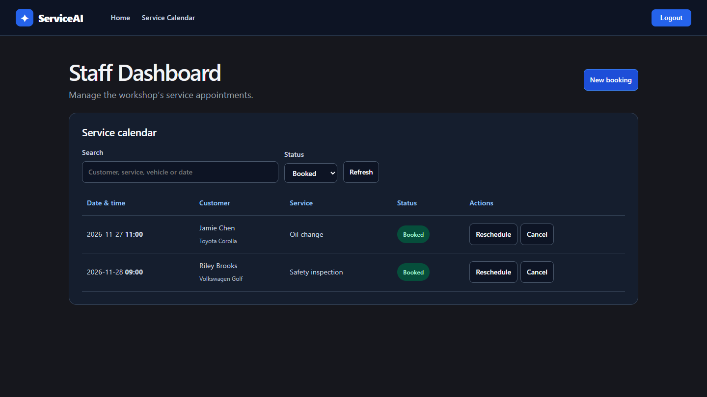

# AI Service Agent

A full-stack prototype for booking vehicle service through a conversational AI assistant. Customers sign in, manage appointments in chat, and see updates in their dashboard without reloading the page.

## Demo

[Watch the 30-second portfolio demo (MP4)](docs/demo/serviceai-portfolio-demo.mp4)

See a customer cancel an appointment through chat without reloading the dashboard, a staff member reschedule a booking, and an administrator update a customer profile. The recording uses fictional data and a simulated AI response. The app performs the booking changes in a separate demo database.

[Customer dashboard](docs/demo/serviceai-customer.png) · [Staff dashboard](docs/demo/serviceai-staff.png) · [Admin dashboard](docs/demo/serviceai-admin.png)



## What you can try

- Sign in as a customer and view your appointments.
- Ask the assistant to check availability, book a service, reschedule, or cancel an appointment. The dashboard re-fetches appointments after a chat response so changes such as a cancellation appear on the same page.
- Start a conversation or reopen an earlier one. The API stores conversation history in SQLite and checks that it belongs to the signed-in customer.
- Staff can search the service calendar, book on behalf of a customer, reschedule appointments, and cancel bookings.
- Administrators can also use the service calendar. The admin dashboard supports searching, creating, and editing customers, with an optional login for new customers. Deletion is limited to customer records without appointments or conversation history.

## How it works

The React and TypeScript frontend calls a FastAPI backend. The Python agent uses Anthropic Claude to select tools from a registry. Backend code authorizes actions against the authenticated customer and validates appointment dates and slots. A partial unique index in SQLite prevents two active bookings for the same slot.

The backend uses JWT authentication and Argon2 password hashing. Login and chat requests are rate-limited. The agent caps the number of tool steps per request, and its responses include execution metadata for debugging.

## Run locally on Windows

You need Python 3.12, Node.js 22.12+ (or Node.js 20.19+ on the 20.x line), and an Anthropic API key for live chat.

```powershell
git clone https://github.com/Thompguy007/ai-service-agent.git
cd ai-service-agent
python -m venv .venv
.\.venv\Scripts\python.exe -m pip install -r requirements.txt
Copy-Item .env.example .env
.\.venv\Scripts\python.exe -c "import secrets; print(secrets.token_urlsafe(48))"
```

Open `.env`, set `ANTHROPIC_API_KEY` to your Anthropic key, and set `JWT_SECRET_KEY` to the generated value. The example uses a separate SQLite file named `portfolio_demo.db`.

From the repository root, create demo accounts in the local demo database. Enter a temporary password for each login.

```powershell
@'
from getpass import getpass

from auth import hash_password
from database import create_database, get_connection

create_database()
connection = get_connection()
try:
    accounts = [
        ("Demo Customer", "Demo Car", "demo@example.com", "customer"),
        ("Demo Staff", "", "staff@example.com", "staff"),
        ("Demo Admin", "", "admin@example.com", "admin"),
    ]
    rows = []
    for name, vehicle, email, role in accounts:
        password = getpass(f"Password for {email}: ")
        rows.append((name, "00000000", vehicle, email, hash_password(password), role))

    with connection:
        connection.executemany(
            """
            INSERT INTO customers (name, phone, vehicle, email, password_hash, role)
            VALUES (?, ?, ?, ?, ?, ?)
            ON CONFLICT(email) DO NOTHING
            """,
            rows,
        )
finally:
    connection.close()
'@ | .\.venv\Scripts\python.exe -

.\.venv\Scripts\python.exe -m uvicorn main:app --reload
```

If a demo account already exists, use its original password. In a second terminal, start the frontend from the repository root.

```powershell
cd frontend
npm.cmd ci
npm.cmd run dev
```

Open [the app](http://localhost:5173) and try the three roles.

- `demo@example.com` can ask the assistant to book or cancel a service and see the dashboard update.
- `staff@example.com` can book for the demo customer, then move or cancel the booking from the service calendar.
- `admin@example.com` can create and edit customer profiles, and can open the service calendar from the navigation.

The [FastAPI docs](http://127.0.0.1:8000/docs) list the API endpoints.

## Tests and build

Run the default backend tests from the repository root. They cover role permissions, staff booking operations, customer administration, appointment constraints, conversation history, rate limiting, and mocked agent behavior. GitHub Actions runs the same suite with test-only configuration.

```powershell
.\.venv\Scripts\python.exe -m pytest
```

The live Claude evaluations are opt-in and require an Anthropic key. Run them against a local demo or test database.

```powershell
.\.venv\Scripts\python.exe -m pytest -m eval -v
```

Run the frontend checks from `frontend`.

```powershell
npm.cmd run lint
npm.cmd run build
```
